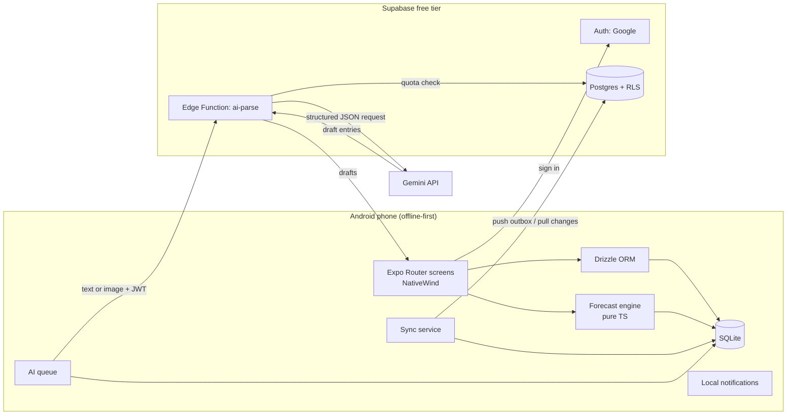

# Baon Tracker — Architecture

> Generated on 2026-11-16 | Moment: **validate**: a solo student MVP, tested with you and a few classmates before anything bigger

## Summary
Baon Tracker is an offline-first Android app for Filipino students. It tracks spending against their allowance cycle (daily, weekly or monthly baon) and answers one question: **"Will my baon last until the next one?"** It's built with Expo + TypeScript. Data lives in SQLite on the phone first and syncs to Supabase when online. AI quick entry (Taglish text and receipt or GCash/Maya screenshots) runs through one Supabase Edge Function that calls the Gemini free tier. Total cost: ₱0/month.

## Dimensions (final)
| Dimension | Value | Source |
|---|---|---|
| project_moment | validate | first app, vibe-coded, portfolio |
| product_type | mobile (Android first) | user answer |
| team_size | 1 | solo |
| user_scale | < 1k (you + classmates) | user answer |
| monthly_budget | free (₱0) | user answer |
| needs_realtime | false | personal data only, nothing shared live |
| access_pattern | balanced: many tiny writes, summary reads | expense logging |
| has_offline_requirement | true | user answer: logging on the jeep with no load |
| latency_critical | false | budgeting app |
| compliance | PH Data Privacy Act of 2012 (personal financial data) | Filipino users |
| ai_complexity | simple: structured extraction + short insights | no RAG, no agents |

## Alignment Score
```
📊 Architecture Alignment — validate moment

  ✅ Expo + TypeScript        — one codebase, test instantly with Expo Go
  ✅ expo-sqlite + Drizzle    — offline-first, matches has_offline = true
  ✅ Supabase (Auth+DB+Edge)  — free tier, uses 3+ features together
  ✅ Gemini via Edge Function — free tier, API key never ships in the app
  ✅ Local notifications      — reminders without a push server
  ⛔ PowerSync / Watermelon   — not needed: each user only edits their own data
  ⛔ Redux / custom backend   — overkill for team_size = 1

  Alignment: 100%: nothing premature in "Use Now"
```

## What We Borrowed From Existing Apps
| Feature | Inspired by | Our twist |
|---|---|---|
| One-tap quick add | Monefy | Category chips made for students: Pagkain, Pamasahe, Load, Print/Xerox, School, Gala |
| Envelopes / per-category budgets | Goodbudget-style apps | Envelopes reset automatically on each baon cycle |
| Calendar view | Money Manager (Realbyte) | Days colored by whether you overspent |
| Offline + ₱ + Cash/GCash/Maya wallets | Pocket Clear | Plus AI entry and a forecast |
| Aesthetic, cute UI | Fleur | Free, no ₱299 paywall |
| Text/voice/receipt AI entry | Papirer, moneasy, EnExpense | Taglish-aware, ₱ default, GCash/Maya screenshot parsing |
| Ipon challenges, gamified budgeting | CashMate, Fortune City | Streaks + ipon goals (Phase 4) |
| **Nobody has this** | — | **"Safe to spend today" forecast tied to your baon cycle** |

## MVP Features (Build Phases)
**Phase 1: core offline tracker (no internet needed)**
- Onboarding: "How do you get baon?" (daily/weekly/monthly), amount, next baon date
- Quick add: number pad + category chip + wallet (Cash/GCash/Maya), 3 taps max
- Home "Baon Meter": remaining balance, days until next baon, **safe-to-spend-today**
- History list grouped by day; edit/delete
- Local reminder: "Did you log today's gastos?" at a time you choose

**Phase 2: accounts + cloud backup**
- Sign in with Google (Supabase Auth)
- Background sync when online; data survives phone changes
- Delete-my-account + export CSV (Data Privacy Act)

**Phase 3: AI quick entry**
- Type `jeep 13, xerox 20, lunch 85 gcash` → AI returns 3 draft entries → user confirms
- Snap a receipt or share a GCash/Maya screenshot → draft entries → confirm
- Queued while offline, sent when back online

**Phase 4: insights + motivation**
- Category pie, weekly bar chart, calendar heatmap
- AI weekly recap (1–3 sentences, Taglish option): "Mas malaki gastos mo sa Gala this week (+40%)"
- Ipon goals + logging streaks

## UI/UX
**Principles**
1. **Log in under 3 seconds.** The quick-add bar is always on the home screen, and the main buttons sit in the bottom thumb zone.
2. **One number that matters.** The home screen shows "Safe to spend today: ₱87" in large type, and the color changes: green = on track, yellow = tight, red = over.
3. **AI drafts, the human confirms.** AI results never save on their own; they open as editable chips first.
4. **Speak like a student.** Use Taglish-friendly copy ("Gastos", "Pamasahe", "Ipon") and ₱ everywhere.
5. **Budget-phone friendly.** Keep the app light, avoid heavy animations, support dark mode, and compress images before upload.

**Screens (bottom tabs: Home · History · Insights · Settings)**
```
┌──────────────────────────┐   ┌──────────────────────────┐
│  Hi Andrei 👋            │   │  Add gastos         ✕    │
│ ┌──────────────────────┐ │   │        ₱ 85              │
│ │ SAFE TO SPEND TODAY  │ │   │ [🍚Pagkain][🚌Pamasahe]  │
│ │       ₱ 87           │ │   │ [📶Load][🖨️Print][📚School]│
│ │ ███████░░░  ₱612 left│ │   │ [🎉Gala][➕Others]        │
│ │ 4 days until baon    │ │   │ Wallet: (Cash) GCash Maya │
│ └──────────────────────┘ │   │ Note: ____________        │
│ Today                    │   │  1   2   3                │
│  🚌 Jeep        ₱13      │   │  4   5   6                │
│  🍚 Lunch       ₱85      │   │  7   8   9                │
│ ┌──────────────────────┐ │   │  .   0   ⌫               │
│ │ "jeep 13, lunch 85"✨│ │   │ [   Save   ]              │
│ └──────────────────────┘ │   └──────────────────────────┘
│ [📷]           [ + Add ] │
│ 🏠  📜  📊  ⚙️           │
└──────────────────────────┘
```

## Architecture Diagram (ASCII)
```
                 ANDROID PHONE (works offline)
┌───────────────────────────────────────────────────────┐
│  Expo Router screens (NativeWind UI)                  │
│     │  read/write                                     │
│     ▼                                                 │
│  Drizzle ORM ──► SQLite (source of truth on device)   │
│     │              transactions, wallets, categories, │
│     │              allowance_cycles, outbox, ai_queue │
│  Forecast engine (pure TS math, no AI)                │
│  Sync service (push outbox / pull changes)            │
│  expo-notifications (local reminders)                 │
└──────────────┬──────────────────────┬─────────────────┘
               │ when online           │ when online
               ▼                       ▼
┌──────────────────────────┐  ┌───────────────────────────┐
│ SUPABASE (free tier)     │  │ Edge Function: ai-parse   │
│  Auth (Google sign-in)   │  │  checks JWT + daily quota │
│  Postgres + RLS          │◄─┤  logs ai_usage            │
│  (user_id = auth.uid())  │  │  calls Gemini (JSON mode) │
└──────────────────────────┘  └─────────────┬─────────────┘
                                            ▼
                                   Gemini API (free tier)
```

## Architecture Diagram (Mermaid)


## Data Model
All money is stored as **integer centavos** (`8500` = ₱85.00). Every synced table has `id uuid`, `user_id`, `created_at`, `updated_at` and `deleted_at` (soft delete).

| Table | Key columns |
|---|---|
| `allowance_cycles` | amount_centavos, frequency (daily/weekly/monthly/custom), next_date |
| `wallets` | name, kind (cash/gcash/maya/bank), starting_balance_centavos |
| `categories` | name, icon, color, envelope_centavos (nullable), is_default |
| `transactions` | wallet_id, category_id, kind (expense/income/baon), amount_centavos, note, occurred_at, source (manual/ai_text/ai_image) |
| `savings_goals` (Phase 4) | name, target_centavos, saved_centavos, deadline |
| `ai_usage` (server only) | user_id, day, count |
| `outbox` / `ai_queue` (device only) | pending sync ops / pending AI requests |

**Forecast formula (Phase 1):**
`remaining = baon_amount − spent_this_cycle`
`days_left = next_baon_date − today` (minimum 1)
`safe_to_spend_today = remaining ÷ days_left`
Status: green if today's spend ≤ safe amount, yellow if within 120%, red otherwise.

## Use Now
### Expo (React Native) + TypeScript + Expo Router
- **Role:** the app itself, with file-based navigation
- **Why now:** product_type = mobile and team_size = 1. Expo Go lets you test on your phone instantly, and AI coding tools handle TS/React Native well.
- **When to replace:** never at this stage. Eject to a bare workflow only if a needed native module isn't supported by Expo (unlikely).

### expo-sqlite + Drizzle ORM
- **Role:** on-device database (the source of truth) and typed queries, with live queries for the UI
- **Why now:** has_offline_requirement = true. Logging must work with no data.
- **When to replace:** when one user edits the same data on 2+ devices and sync conflicts exceed ~1 per week. Then consider PowerSync.

### Supabase (Auth + Postgres + Edge Functions)
- **Role:** Google sign-in, cloud backup and sync target, and a secure home for the AI call
- **Why now:** user_scale = you + classmates, so data must survive phone changes. Budget = free, and using 3 features together fits the "Mobile + Validate + Solo + Free" recipe.
- **When to replace:** when the DB exceeds the free-tier size, or monthly active users reach 50% of the free-tier MAU limit. Upgrade to Pro; don't migrate.

### Gemini API (free tier, Flash-class model) via Edge Function
- **Role:** turns Taglish text and receipt/GCash screenshots into JSON draft entries; writes weekly recaps
- **Why now:** ai_complexity = simple and budget = free. It's multimodal, so one provider covers both text and images.
- **When to replace:** when free-tier quota errors (HTTP 429) hit more than 5% of AI requests over a week. Enable paid billing or switch to a cheaper model.

### NativeWind (Tailwind for React Native)
- **Role:** styling
- **Why now:** vibe-coding friendly, since AI tools write Tailwind well. It also makes a consistent theme and dark mode easy.
- **When to replace:** not at this stage.

### react-native-gifted-charts
- **Role:** pie, bar and line charts in Insights
- **Why now:** simple API, works in Expo, and the charts are small.
- **When to replace:** if you need charts with 1,000+ points or complex gestures. Then try victory-native.

### Zustand
- **Role:** small UI state (current cycle, sync status, draft entries)
- **Why now:** team_size = 1, and most data already comes from SQLite live queries.
- **When to replace:** not at this stage.

### expo-notifications (local only), expo-image-picker, expo-image-manipulator
- **Role:** reminders; picking and compressing receipt/screenshot images before upload
- **Why now:** reminders without a push server; compression saves the user's load and AI tokens.

### EAS Build (free tier) + Expo Go
- **Role:** dev testing (Expo Go) and building a shareable APK for classmates (EAS)
- **Why now:** Android first, free, and no Play Store needed for a small test group.
- **When to replace:** publish to the Play Store once 20+ testers want it.

## Add Later
- **Google Play Store listing** — add when 20+ classmates are actively using the APK. Not now because sharing an APK directly is free and faster for feedback.
- **Sentry (error tracking, free tier)** — add when you have 10+ testers or receive your first crash report you can't reproduce. Not now because you're the only user.
- **PostHog (product analytics, free tier)** — add when you have 30+ users and need to know which features they actually use. Not now because you can just ask 5 classmates.
- **PowerSync** — add when multi-device sync conflicts exceed ~1 per week. Not now because each user only edits their own data, so last-write-wins is enough.
- **Server push notifications** — add when you need reminders triggered by the server (e.g., shared group budgets). Not now because local notifications cover all Phase 1–4 reminders.
- **iPhone build** — add when 10+ interested iPhone users ask for it. Not now because publishing on iOS costs ~$99/yr and budget = free.
- **"Ask your gastos" AI chat** — add when 70% of testers have logged 30+ days of data. Not now because the chat answers are useless without history.

## Don't Use Now
- **Linking GCash/Maya/bank accounts** — there's no public personal API, and asking for logins is a privacy risk. Parse screenshots instead. Reconsider when an official open-finance API is available to individual developers.
- **Redux / MobX** — too much boilerplate for team_size = 1. Reconsider when there are 3+ devs, or state logic grows beyond ~10 Zustand stores.
- **Custom Node/Express backend** — Supabase plus one Edge Function covers everything. Reconsider when you need 5+ server endpoints with complex business logic.
- **LangChain / vector DB / RAG** — the AI only does extraction and short summaries, with no document search. Reconsider when you add chat over 6+ months of history.
- **Firebase alongside Supabase** — two backends double the setup and confuse the AI coding agent. Reconsider only if switching backends entirely.
- **WatermelonDB / Realm** — heavier setup than expo-sqlite + Drizzle for the same result here. Reconsider when you're past 100k rows per user (won't happen).

## Architecture Decision Records
### ADR-001: Offline-first with SQLite as source of truth
- **Choice:** All reads and writes go to SQLite on the phone. A sync service pushes an outbox to Supabase and pulls rows with `updated_at > last_pulled_at`, using last-write-wins.
- **Why:** Students log expenses on the jeep or in school with no load. An online-only app would fail exactly when they need it.
- **Tradeoff:** More code than calling Supabase directly. Rare edits on two devices at once can overwrite each other.
- **Revisit when:** sync conflicts exceed ~1 per week, or shared or group budgets are added.

### ADR-002: Supabase over Firebase
- **Choice:** Supabase (Postgres + Row Level Security + Edge Functions)
- **Why:** You get real SQL practice (useful for an IT degree and AI-engineering roles), RLS gives per-user security in one line of policy, and it matches the earlier stack choice.
- **Tradeoff:** Free projects pause after a period of inactivity, and there's less offline magic than Firestore.
- **Revisit when:** you need a feature only Firebase offers.

### ADR-003: AI runs only on the server, through one Edge Function
- **Choice:** The app sends text or a compressed image plus the user's JWT to `ai-parse`. The function checks a daily quota (e.g., 30 calls/user/day), calls Gemini with a JSON schema, and returns drafts.
- **Why:** The Gemini API key must never be inside the APK (it can be extracted), and the quota protects the free tier from one heavy user.
- **Tradeoff:** AI features need internet; offline requests sit in `ai_queue`.
- **Revisit when:** AI usage hits the free-tier limit on more than 5% of requests.

### ADR-004: The forecast is plain math, not AI
- **Choice:** Safe-to-spend and days-left are computed in TypeScript on the device.
- **Why:** This is the core feature. It has to be instant, work offline, cost nothing, and always be correct.
- **Tradeoff:** No "smart" forecast yet.
- **Revisit when:** users have 3+ months of data, and a pattern-based forecast (e.g., "you overspend on Fridays") clearly beats the simple formula in tests.

### ADR-005: AI output is always an editable draft
- **Choice:** Parsed entries appear as confirm/edit chips and are saved only after the user taps Confirm.
- **Why:** AI can misread amounts. Wrong money data destroys trust in a budget app.
- **Tradeoff:** One extra tap.
- **Revisit when:** a manual edit is needed on fewer than 2% of AI drafts over a month (then offer "auto-save").

### ADR-006: Money as integer centavos
- **Choice:** `amount_centavos INTEGER` everywhere. Format to ₱ only in the UI.
- **Why:** Floating-point math breaks money (0.1 + 0.2 ≠ 0.3).
- **Tradeoff:** You have to remember to convert in the UI.
- **Revisit when:** never.

## Privacy (PH Data Privacy Act of 2012)
- Show a simple consent screen on sign-up that says what is stored and why.
- Receipt and screenshot images are sent for parsing only and are **not stored** by default.
- Free-tier AI providers may use submitted content to improve their products. Check Gemini's current terms, and tell users not to scan anything sensitive (like full account numbers).
- Provide "Export my data (CSV)" and "Delete my account" in Settings.
- RLS on every table: users can only read and write rows where `user_id = auth.uid()`.

## Cost Estimate
- **Monthly now:** ₱0 (Supabase free tier, Gemini free tier, EAS free builds, APK shared directly)
- **Monthly at next stage:** ~₱0–₱1,500/month. Google Play has a one-time US$25 developer fee; Supabase Pro is ~US$25/month only if you outgrow the free tier; paid Gemini usage stays a few pesos per active user at Flash-class prices.
### Cost Traps
- **Supabase free projects pause after about a week with no activity.** Classmates' sync fails until you resume it. Open the dashboard or keep testing regularly.
- **Uploading full-resolution photos** burns user data and AI tokens. Always resize to ~1024px and compress to JPEG ~70% before sending.
- **Storing receipt images in Supabase Storage** eats the free storage quota fast. Don't store them in the MVP.
- **No per-user AI quota** means one tester spamming the scan button can exhaust the free tier for everyone. Enforce the daily limit in the Edge Function.
- **EAS free build queue** can be slow. Use Expo Go for daily testing and run EAS builds only to share an APK.

## Agent Rules
- ALWAYS store money as integer centavos (`amount_centavos`). NEVER use floats for money.
- ALWAYS read and write app data through Drizzle + expo-sqlite. NEVER call Supabase tables directly from screens.
- ALWAYS write changes to the local `outbox` so the sync service can push them. Sync is last-write-wins on `updated_at`.
- ALWAYS soft-delete (`deleted_at`) synced rows. NEVER hard-delete them.
- NEVER put the Gemini API key or any secret in the app code or `app.json`. AI calls go ONLY through the `ai-parse` Supabase Edge Function.
- ALWAYS treat AI output as a draft that the user confirms before saving. Validate AI JSON with zod before showing it.
- ALWAYS compress images (max 1024px, JPEG ~0.7) before uploading to `ai-parse`.
- ALWAYS enable Row Level Security on every Supabase table, with policies on `user_id = auth.uid()`.
- The forecast (safe-to-spend, days-left) MUST be pure TypeScript functions with unit tests. DO NOT use AI for it.
- DO NOT add Redux, Firebase, LangChain, a vector DB, a custom Node backend, PowerSync or WatermelonDB.
- DO NOT integrate GCash/Maya/bank logins.
- Use NativeWind for styling and Expo Router for navigation. Keep UI copy in English with Taglish labels (Pagkain, Pamasahe, Ipon).
- Build in phase order: Phase 1 (offline core) must work without an account before adding auth, sync or AI.
- Target Android first. Test with Expo Go; ship test builds as APKs via EAS.

## Changelog
| Date | Reason | Changes |
|------|--------|---------|
| 2026-11-16 | Initial generation | — |

---
To update, run `/planfirst` again.
